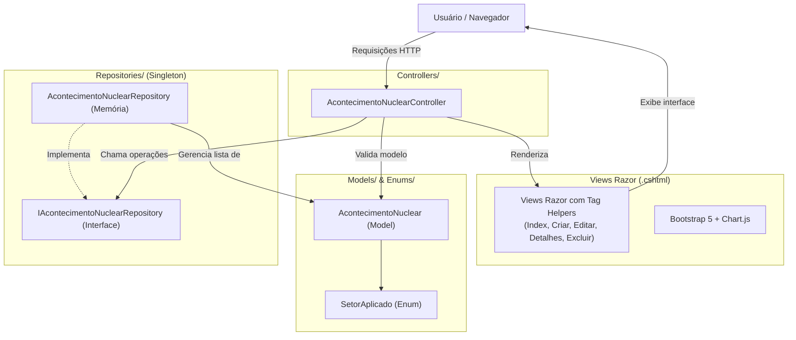

# Integrantes
     Paulo Cavalcante Caroba - RM566667
     Renan da Silva Paulino - RM566610
     Sergio Henrique Santos - RM567254

## Descrição do Projeto
O **RegistraNuclearTech** é uma aplicação web desenvolvida em **ASP.NET Core MVC** no **.NET10** voltada ao registro, catalogação e análise de acontecimentos históricos, inovações científicas e marcos regulatórios da tecnologia nuclear global e nacional.

A solução oferece uma interface moderna que permite o gerenciamento completo (CRUD) de acontecimentos em setores estratégicos como Saúde, Energia, Agricultura, Indústria e Pesquisa, acompanhados de métricas analíticas e pesquisa dinâmica por país.
Pensamos nessa solução, como uma possível funcionalidade dentro da entrega do Challenge FIAP 2026-2027 do 2º ano de curso.

## Arquitetura e Padrões Adotados
O projeto segue o padrão **Model-View-Controller (MVC)** nativo do ASP.NET Core:



## Diagrama de Classes

```mermaid
classDiagram
    class SetorAplicado {
        <<enum>>
        Saude
        Industria
        Agricultura
        Pesquisa
        Energia
    }

    class AcontecimentoNuclear {
        +int Id
        +string Titulo
        +int Ano
        +SetorAplicado Setor
        +string Pais
        +string Descricao
        +bool ImpactoPositivo
        +DateTime DataRegistro
    }

    class IAcontecimentoNuclearRepository {
        <<interface>>
        +ListarTodos() IEnumerable~AcontecimentoNuclear~
        +BuscarAcontecimentoPorId(int id) AcontecimentoNuclear
        +Criar(AcontecimentoNuclear acontecimento) AcontecimentoNuclear
        +Atualizar(AcontecimentoNuclear acontecimento) AcontecimentoNuclear
        +Apagar(int id) bool
        +BuscarPorPais(string pais) IEnumerable~AcontecimentoNuclear~
    }

    class AcontecimentoNuclearRepository {
        -List~AcontecimentoNuclear~ _acontecimentos$
        -int idAtual$
    }

    IAcontecimentoNuclearRepository <|.. AcontecimentoNuclearRepository
    AcontecimentoNuclearRepository --> AcontecimentoNuclear
    AcontecimentoNuclear --> SetorAplicado
 ```

## Telas do Sistema (Implementação e Funcionamento)

#### Dashboard e Listagem Principal (Index.cshtml)
   - Implementação: Contém métricas consolidadas (Total de Registros, Impacto Positivo vs Negativo), barra de busca com formulário GET direcionado ao método BuscarPorPais, tabela centralizada com destaque no ano e setor, e gráficos em pizza (Chart.js) preenchidos dinamicamente de acordo com os dados existentes.
   - Funcionamento: Permite visualizar todos os acontecimentos cadastrados, filtrar por país em tempo real e acessar as ações individuais de cada item.


#### Cadastro de Acontecimento (Criar.cshtml)
   - Implementação: Formulário em card Dark Tech utilizando Tag Helpers (asp-for, asp-validation-for, asp-items populando o SetorAplicado via Enum). Inclui validações de cliente via _ValidationScriptsPartial.
   - Funcionamento: O usuário informa os dados do evento histórico. Em caso de inconsistência, mensagens de validação impedem o envio. Ao salvar, os dados são persistidos no repositório em memória e o usuário é redirecionado à Index.


#### Edição de Registro (Editar.cshtml)
   - Implementação: Formulário com os campos pré-carregados utilizando <input type="hidden" asp-for="Id" /> para manter a integridade do identificador.
   - Funcionamento: Permite retificar títulos, anos, países, setores ou impacto. A data original de registro é preservada no repositório.


####  Visualização de Detalhes (Detalhes.cshtml)
   - Implementação: Card estruturado exibindo todas as propriedades da entidade, formatando a data de inclusão e sinalizando o impacto por badges coloridas.
   - Funcionamento: Consulta somente-leitura dos dados de um marco nuclear.


####  Confirmação de Exclusão (Excluir.cshtml)
   - Implementação: Tela dedicada de segurança (atendendo ao requisito explícito de confirmação de exclusão), apresentando um resumo do item a ser excluído e formulário POST com proteção [ValidateAntiForgeryToken].
   - Funcionamento: Garante que nenhum registro seja apagado por engano no navegador. A remoção só é efetivada após o clique no botão de confirmação.


## Dependências, Extensões e Bibliotecas
   - Framework: .NET 10.0 (ASP.NET Core MVC)
   - Front-end:
     - Bootstrap 5 (Estilização responsiva e componentes utilitários)
     - Chart.js via CDN (Renderização dos gráficos analíticos)
     - Tag Helpers nativos (Microsoft.AspNetCore.Mvc.TagHelpers)
   - IDE Utilizada: Microsoft Visual Studio 2022 / 2026

##  Instruções de Execução
   1. Clone o repositório ou descompacte o arquivo .zip.
   2. Abra a solução RegistraNuclearTech.sln ou RegistraNuclearTech.slnx no Visual Studio 2022/2026.
   3. Certifique-se de que o perfil de inicialização esteja configurado para a aplicação web (IIS Express ou Kestrel). 
   4. Pressione F5 ou Ctrl + F5 para compilar e executar.
   5. O navegador abrirá automaticamente na porta local configurada (ex: https://localhost:5174/).

## Endpoints e Rotas
| Método HTTP | Rota | Descrição |
|-------------|---------------|-----------|
| GET | `/AcontecimentoNuclear` ou `/` | Página inicial com métricas, listagem central e busca por país |
| GET | `/AcontecimentoNuclear/Criar` | Exibição do formulário de cadastro de novo marco nuclear |
| POST | `/AcontecimentoNuclear/Criar` | Processamento do cadastro com validação de dados |
| GET | `/AcontecimentoNuclear/Detalhes/{id}` | Exibição detalhada de um acontecimento específico |
| GET | `/AcontecimentoNuclear/Editar/{id}` | Formulário de edição dos dados de um registro existente |
| POST | `/AcontecimentoNuclear/Editar/{id}` | Persistência das alterações do registro |
| GET | `/AcontecimentoNuclear/Excluir/{id}` | Tela de confirmação obrigatória de remoção |
| POST | `/AcontecimentoNuclear/Excluir/{id}` | Efetivação da exclusão do registro em memória |


